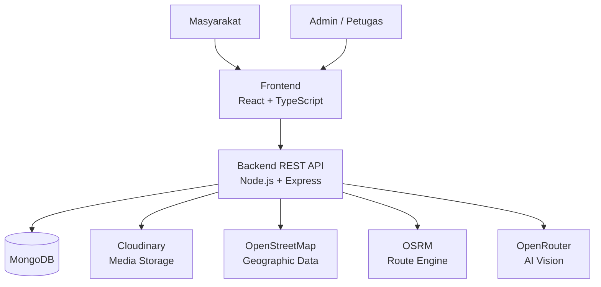
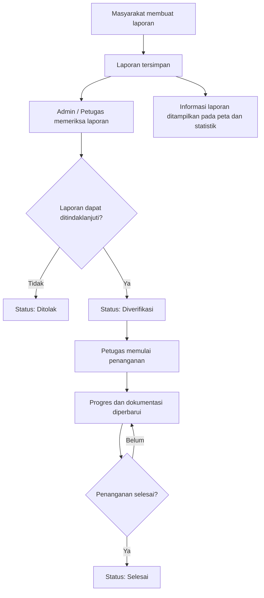

<div align="center">

# PANTAR: Pantau Sekitar

### Bersama Mewujudkan Infrastruktur Publik yang Lebih Baik

Platform digital untuk melaporkan kerusakan fasilitas umum, memantau proses penanganannya, dan membantu masyarakat menemukan rute dengan mempertimbangkan kondisi jalan.

</div>

---

## Tentang PANTAR

**PANTAR** adalah platform yang menghubungkan masyarakat dengan proses penanganan kerusakan fasilitas umum. Melalui platform ini, masyarakat dapat menyampaikan laporan kerusakan, melengkapi laporan dengan foto dan lokasi, serta memantau perkembangan penanganannya secara transparan.

PANTAR juga menyediakan informasi statistik laporan dan fitur navigasi yang mempertimbangkan titik kerusakan jalan. Dengan begitu, informasi yang dikumpulkan dari laporan masyarakat tidak hanya menjadi dokumentasi, tetapi juga dapat menjadi informasi pendukung ketika pengguna merencanakan perjalanan.

Project ini dikembangkan dengan pendekatan **full-stack web application**, yang terdiri dari frontend untuk masyarakat dan petugas serta backend sebagai REST API.

## Fitur Utama

### 1. Pelaporan Kerusakan Fasilitas Umum

Masyarakat dapat membuat laporan kerusakan fasilitas umum dengan menyertakan:

- Judul dan deskripsi kerusakan.
- Kategori fasilitas yang mengalami kerusakan.
- Tingkat keparahan kerusakan.
- Foto sebagai dokumentasi.
- Lokasi kerusakan berdasarkan koordinat.

Kategori laporan yang tersedia:

| Kategori | Keterangan |
|---|---|
| Jalan | Kerusakan pada badan atau permukaan jalan. |
| Lampu jalan | Lampu penerangan jalan yang rusak atau tidak berfungsi. |
| Trotoar | Kerusakan pada jalur pedestrian. |
| Halte | Kerusakan fasilitas halte. |
| Taman | Kerusakan fasilitas taman publik. |
| Lainnya | Kerusakan fasilitas umum di luar kategori yang tersedia. |

### 2. Pemantauan Progres Penanganan

Masyarakat dapat melihat detail laporan dan mengikuti perkembangan penanganannya melalui timeline progres.

Petugas dapat menambahkan dokumentasi pada setiap tahap penanganan, termasuk foto dan informasi biaya penanganan. Informasi progres ditampilkan pada halaman detail laporan agar masyarakat dapat mengetahui perkembangan tindak lanjut.

Status laporan:

`menunggu` → `diverifikasi` → `diproses` → `selesai`

Laporan juga dapat memiliki status `ditolak` apabila tidak dapat ditindaklanjuti.

### 3. Statistik Laporan Publik

PANTAR menyediakan ringkasan dan visualisasi data laporan untuk membantu masyarakat memahami kondisi fasilitas umum yang dilaporkan.

Informasi statistik dapat dikelompokkan berdasarkan beberapa dimensi, seperti:

- Status laporan.
- Kategori kerusakan.
- Tingkat keparahan.
- Wilayah atau lokasi laporan.

### 4. Navigasi dengan Mempertimbangkan Kerusakan Jalan

Fitur navigasi menampilkan peta, pilihan lokasi awal dan tujuan, serta titik kerusakan yang berasal dari laporan.

Pengguna dapat memilih jenis perjalanan:

- Mobil.
- Motor.
- Jalan kaki.

Backend memproses permintaan rute dengan memanfaatkan layanan OSRM dan data laporan kerusakan untuk mencari alternatif rute sesuai aturan yang diterapkan. Titik kerusakan ditampilkan pada peta agar pengguna memperoleh informasi tambahan sebelum atau selama merencanakan perjalanan.

> Ketersediaan dan akurasi rute alternatif bergantung pada data OpenStreetMap, layanan routing, serta kelengkapan dan kebaruan laporan kerusakan. Informasi ini bukan jaminan bahwa seluruh kondisi jalan telah terpetakan.

### 5. Dashboard Admin dan Petugas

Area admin/petugas menyediakan fitur untuk:

- Melihat ringkasan laporan pada dashboard.
- Menelusuri dan memfilter laporan.
- Melihat detail laporan masyarakat.
- Mengelola tindak lanjut dan status laporan.
- Menambahkan serta memperbarui progres perbaikan.
- Mengunggah dokumentasi proses penanganan.
- Meninjau hasil validasi otomatis dan menentukan keputusan akhir laporan.
- Mengelola pengguna sesuai hak akses.

### 6. Dukungan Multibahasa

Antarmuka menyediakan pilihan bahasa:

- Bahasa Indonesia.
- English.
- Cakap Medan.

### 7. Validasi Laporan Otomatis dengan AI

Setiap laporan baru dinilai secara otomatis agar petugas dapat berfokus pada laporan yang benar benar membutuhkan perhatian. AI hanya berperan sebagai penasihat. Laporan tidak pernah dihapus otomatis dan keputusan akhir tetap berada pada petugas.

Penilaian berjalan dalam dua tahap dan menghasilkan `validation.trustScore` (0 sampai 100, skor dasar 50) serta `validation.status`.

**Tahap 1, pemeriksaan aturan (tanpa AI, berjalan sebelum response dikirim):**

| Pemeriksaan | Dampak skor |
|---|---|
| Foto identik (SHA 256) atau sangat mirip (perceptual hash dHash) dengan laporan lain di lokasi yang sama | Ditandai `duplicate` |
| Foto yang sama dipakai pada laporan di lokasi berbeda | -50 |
| Laporan sejenis di titik yang sangat dekat | -10 |
| Koordinat di luar wilayah Indonesia atau tanpa koordinat | Ditandai `flagged` |
| Titik laporan jenis `jalan` jauh dari jalan terdekat (OSRM) | -20 (dekat jalan: +5) |
| GPS EXIF foto cocok dengan titik laporan | +15 (selisih besar: -25) |
| Waktu pengambilan foto baru (EXIF) | +10 (terlalu lama: -25) |
| Metadata menunjukkan foto diedit atau dihasilkan software | -20 |
| Tanpa foto, foto tidak terbaca, atau resolusi terlalu kecil | -15 sampai -10 |
| Deskripsi terlalu singkat atau berisi karakter berulang | -10 sampai -15 |

EXIF hanya menjadi sinyal tambahan. Foto tanpa EXIF (misalnya dari WhatsApp atau screenshot) tidak dihukum, dan lokasi laporan tetap berasal dari titik yang dipilih pelapor di peta.

**Tahap 2, analisis AI vision melalui [OpenRouter](https://openrouter.ai/):**

Foto diperkecil lalu dikirim ke model vision. Model dicoba berurutan sesuai `AI_VISION_MODELS`, dan jika sebuah model gagal, sistem lanjut ke model berikutnya. Model mengembalikan JSON berisi:

- Apakah kerusakan terlihat pada foto.
- Kesesuaian foto dengan judul dan deskripsi.
- Apakah foto berupa foto layar, gambar stok, atau tidak relevan.
- Saran `type` dan `severity` (hanya disimpan di `validation.ai`, tidak mengubah laporan).
- Tingkat keyakinan (`confidence`) dan alasan singkat.

| Hasil AI | Dampak skor |
|---|---|
| Kerusakan terkonfirmasi | +25 |
| Kerusakan tidak terlihat | -45 |
| Foto tidak relevan atau stok | -40 |
| Foto tidak sesuai deskripsi | -15 |
| Foto hasil foto layar | -10 |
| Keyakinan di bawah `AI_MIN_CONFIDENCE` | 0, perlu dicek petugas |

**Status validasi:**

| `validation.status` | Arti | Tampil di publik |
|---|---|:---:|
| `pending` | Baru masuk atau menunggu AI | Ya |
| `auto_verified` | Skor mencapai batas otomatis, laporan `menunggu` langsung menjadi `diverifikasi` | Ya |
| `needs_review` | Skor menengah atau AI gagal, perlu dicek petugas | Ya |
| `flagged` | Skor rendah atau mencurigakan | Tidak |
| `duplicate` | Duplikat laporan lain (`validation.duplicateOf`) | Tidak |
| `approved` | Disetujui petugas | Ya |
| `rejected` | Ditolak petugas, laporan menjadi `ditolak` | Tidak |

Secara default skor 70 ke atas menjadi `auto_verified`, skor 40 sampai 69 menjadi `needs_review`, dan di bawah 40 menjadi `flagged`. Ambang ini dapat diubah melalui `VALIDATION_AUTO_VERIFY_MIN` dan `VALIDATION_REVIEW_MIN`.

**Keamanan dan ketahanan:**

- Teks laporan diperlakukan sebagai data, bukan perintah, dan instruksi apa pun di dalam foto atau teks laporan diabaikan oleh model.
- Jika AI gagal setelah 3 percobaan, laporan tidak pernah menjadi `auto_verified` dan dialihkan ke `needs_review`.
- Hanya gambar JPG, PNG, dan WebP yang dianalisis. Audio dan video hanya diunggah sebagai dokumentasi.
- Keputusan petugas (`approved` atau `rejected`) tidak pernah ditimpa oleh proses otomatis.
- Pengirim laporan dibatasi per jam (`VALIDATION_MAX_PER_HOUR`, default 10 per device dan 3 kali lipat per IP) dan akan menerima respons `429` jika melebihi batas. IP disimpan dalam bentuk hash bersalt.
- Masyarakat hanya menerima `validation.status`. Skor, daftar pemeriksaan, hasil AI, hash foto, dan GPS EXIF hanya tersedia bagi petugas atau tidak dikirim sama sekali.

**Mode pemrosesan AI** (`AI_VALIDATION_MODE`):

| Mode | Perilaku |
|---|---|
| `background` | Default di server biasa. AI berjalan setelah response dengan jeda antar laporan agar tidak melewati rate limit. |
| `queue` | Default di Vercel. Laporan ditandai `pending` lalu diproses lewat `GET` atau `POST /api/validation/process`, yang dapat dipanggil Cron dengan `CRON_SECRET` atau dari dashboard petugas. |
| `inline` | AI berjalan sebelum response dikirim. Lambat dan tidak disarankan. |

Jika `OPENROUTER_API_KEY` kosong, tahap AI dilewati dan pemeriksaan aturan tetap berjalan.

**Peran petugas pada validasi:** memfilter antrean (misalnya `needs_review`), menyetujui, menolak, atau menandai duplikat sebuah laporan, menjalankan ulang validasi, memproses antrean AI, serta melihat statistik validasi dari dashboard.

---

## Teknologi yang Digunakan

### Frontend

| Teknologi | Penggunaan |
|---|---|
| [React](https://react.dev/) | Library antarmuka pengguna. |
| [TypeScript](https://www.typescriptlang.org/) | Static typing pada frontend. |
| [Vite](https://vite.dev/) | Development server dan build tool. |
| [Tailwind CSS](https://tailwindcss.com/) | Styling antarmuka. |
| [React Router](https://reactrouter.com/) | Routing halaman. |
| [Axios](https://axios-http.com/) | Komunikasi HTTP dengan backend. |
| [Leaflet](https://leafletjs.com/) & [React Leaflet](https://react-leaflet.js.org/) | Peta interaktif. |
| [OpenStreetMap](https://www.openstreetmap.org/) | Data peta. |
| [i18next](https://www.i18next.com/) | Internasionalisasi dan pengelolaan bahasa. |
| [Framer Motion](https://motion.dev/) | Animasi antarmuka. |
| [Lucide](https://lucide.dev/) | Ikon antarmuka. |
| [SweetAlert2](https://sweetalert2.github.io/) | Notifikasi dan dialog interaktif. |

### Backend

| Teknologi | Penggunaan |
|---|---|
| [Node.js](https://nodejs.org/) | Runtime JavaScript. |
| [Express](https://expressjs.com/) | REST API. |
| [MongoDB](https://www.mongodb.com/) | Database. |
| [Mongoose](https://mongoosejs.com/) | ODM untuk MongoDB. |
| [JSON Web Token](https://jwt.io/) | Autentikasi berbasis token. |
| [bcryptjs](https://www.npmjs.com/package/bcryptjs) | Hash password. |
| [Multer](https://www.npmjs.com/package/multer) | Middleware upload file. |
| [Cloudinary](https://cloudinary.com/) | Penyimpanan dan pengelolaan media. |
| [OSRM](https://project-osrm.org/) | Perhitungan rute. |
| [OpenStreetMap](https://www.openstreetmap.org/) | Sumber data geografis. |
| [OpenRouter](https://openrouter.ai/) | Akses model AI vision untuk validasi foto laporan. |
| [Sharp](https://sharp.pixelplumbing.com/) | Pemrosesan gambar: perkecil untuk AI, perceptual hash, dan pembacaan metadata EXIF. |

---

## Arsitektur Project

PANTAR menggunakan arsitektur frontend dan backend yang terpisah. Frontend berkomunikasi dengan backend melalui REST API.



### Alur Utama Aplikasi



> Setelah laporan tersimpan, sistem menjalankan validasi otomatis (aturan dan AI). Laporan dengan skor tinggi langsung berstatus `diverifikasi`, sedangkan laporan yang meragukan masuk antrean tinjauan petugas. Lihat bagian [Validasi Laporan Otomatis dengan AI](#7-validasi-laporan-otomatis-dengan-ai).

## Struktur Repository

```text
PANTAR/
├── backend/
│   ├── src/
│   │   ├── config/          # Konfigurasi database dan Cloudinary
│   │   ├── controllers/     # Handler endpoint API
│   │   ├── middlewares/     # Auth, upload, pembatas kiriman, dan error handling
│   │   ├── models/          # Model User, Report, RepairProgress
│   │   ├── routes/          # Definisi route API
│   │   ├── seeds/           # Seed akun admin
│   │   ├── services/        # Geocoding, routing, dan validasi laporan (aturan dan AI)
│   │   ├── utils/           # Helper dan utilitas
│   │   ├── app.js
│   │   └── server.js
│   ├── tests/               # Tes logika validasi dan media (npm test)
│   ├── .env.example
│   ├── package.json
│   └── README.md
│
├── frontend/
│   ├── public/              # Aset statis
│   ├── src/
│   │   ├── components/      # Komponen bersama
│   │   ├── config/          # Konfigurasi API
│   │   ├── i18n/            # Konfigurasi dan file bahasa
│   │   ├── layouts/         # Layout aplikasi
│   │   ├── pages/
│   │   │   ├── admin/       # Halaman admin/petugas
│   │   │   └── client/      # Halaman masyarakat
│   │   ├── utils/
│   │   ├── App.tsx
│   │   └── main.tsx
│   ├── .env.example
│   ├── package.json
│   └── README.md
│
└── README.md
```

---

## Menjalankan Project Secara Lokal

### Persyaratan

Pastikan perangkat sudah memiliki:

- Node.js 18 atau lebih baru.
- npm.
- MongoDB lokal atau MongoDB Atlas.
- Akun Cloudinary untuk penyimpanan media.
- Koneksi internet untuk layanan peta dan routing.
- (Opsional) API key OpenRouter untuk validasi foto otomatis dengan AI.

### 1. Clone Repository

```bash
git clone <URL_REPOSITORY>
cd PANTAR
```

Ganti `<URL_REPOSITORY>` dengan URL repository GitHub project.

### 2. Menjalankan Backend

Masuk ke folder backend:

```bash
cd backend
npm install
```

Salin file environment:

```bash
cp .env.example .env
```

Sesuaikan konfigurasi pada `.env`, terutama:

```env
PORT=5000
MONGO_URI=mongodb://127.0.0.1:27017/nama_db
BASE_URL=http://localhost:5000

JWT_SECRET=your_strong_secret
JWT_EXPIRES_IN=7d

ADMIN_NAME=Administrator
ADMIN_EMAIL=admin@pantar.local
ADMIN_PASSWORD=change_this_password

CLOUDINARY_CLOUD_NAME=your_cloud_name
CLOUDINARY_API_KEY=your_api_key
CLOUDINARY_API_SECRET=your_api_secret

# Opsional: kosong berarti tahap AI dilewati
OPENROUTER_API_KEY=your_openrouter_api_key
```

Buat akun admin awal:

```bash
npm run seed:admin
```

Jalankan backend dalam mode development:

```bash
npm run dev
```

Backend secara default berjalan di:

```text
http://localhost:5000
```

### 3. Menjalankan Frontend

Buka terminal baru, kemudian:

```bash
cd frontend
npm install
```

Salin file environment:

```bash
cp .env.example .env
```

Atur URL backend:

```env
VITE_API_BASE_URL=http://localhost:5000
```

Jalankan frontend:

```bash
npm run dev
```

Frontend secara default dapat diakses melalui:

```text
http://localhost:5173
```

---

## Environment Variables

### Backend

Konfigurasi lengkap tersedia pada `backend/.env.example`.

| Variabel | Keterangan |
|---|---|
| `PORT` | Port server backend. |
| `MONGO_URI` | Connection string MongoDB. |
| `BASE_URL` | Base URL backend. |
| `JWT_SECRET` | Secret untuk JWT. |
| `JWT_EXPIRES_IN` | Masa berlaku token. |
| `ADMIN_NAME` | Nama admin awal untuk seed. |
| `ADMIN_EMAIL` | Email admin awal untuk seed. |
| `ADMIN_PASSWORD` | Password admin awal untuk seed. |
| `CLOUDINARY_CLOUD_NAME` | Cloud name Cloudinary. |
| `CLOUDINARY_API_KEY` | API key Cloudinary. |
| `CLOUDINARY_API_SECRET` | API secret Cloudinary. |
| `OSRM_URL` | URL layanan OSRM utama. |
| `OSRM_PROFILE` | Profil routing utama. |
| `OSRM_FOOT_URL` | URL layanan OSRM untuk pejalan kaki. |
| `OSRM_FOOT_PROFILE` | Profil routing pejalan kaki. |
| `OSRM_TIMEOUT_MS` | Timeout request OSRM. |
| `ROUTING_*` | Pengaturan penghindaran hazard dan alternatif rute. |
| `OPENROUTER_API_KEY` | Kunci OpenRouter. Kosong berarti tahap AI dilewati. |
| `AI_VALIDATION_ENABLED` | Mengaktifkan atau menonaktifkan validasi AI. |
| `AI_VISION_MODELS` | Daftar model vision yang dicoba berurutan (nilai default ada di `.env.example`). |
| `AI_TIMEOUT_MS` | Batas waktu satu panggilan model. |
| `AI_MAX_IMAGES` | Jumlah maksimal foto per laporan yang dikirim ke AI. |
| `AI_MIN_CONFIDENCE` | Batas keyakinan minimum agar hasil AI dipakai dalam penilaian. |
| `AI_VALIDATION_MODE` | Mode pemrosesan AI: `inline`, `background`, atau `queue`. |
| `CRON_SECRET` | Rahasia agar Cron dapat memanggil `/api/validation/process`. |
| `VALIDATION_AUTO_VERIFY_MIN` | Skor minimum untuk status `auto_verified`. |
| `VALIDATION_REVIEW_MIN` | Skor minimum untuk status `needs_review`. |
| `VALIDATION_MAX_PER_HOUR` | Batas laporan per device per jam (per IP 3 kali lipat). |
| `VALIDATION_DUP_IMAGE_RADIUS_M` | Radius foto sama dianggap duplikat. |
| `VALIDATION_EXIF_MATCH_M` | Selisih GPS foto dan titik laporan yang dianggap cocok. |
| `VALIDATION_ROAD_MAX_M` | Jarak maksimal titik laporan jenis jalan dari jalan terdekat. |
| `UPLOAD_MAX_IMAGE_MB`, `UPLOAD_MAX_AUDIO_MB`, `UPLOAD_MAX_VIDEO_MB` | Batas ukuran upload per jenis file. |

### Frontend

| Variabel | Keterangan |
|---|---|
| `VITE_API_BASE_URL` | URL dasar REST API backend. |

> Jangan mengunggah file `.env` ke repository publik. Variabel `VITE_` akan masuk ke bundle frontend, sehingga hanya gunakan untuk konfigurasi yang memang aman diketahui browser.

---

## Ringkasan Endpoint API

Base URL lokal:

```text
http://localhost:5000
```

| Modul | Prefix | Fungsi |
|---|---|---|
| Authentication | `/api/auth` | Registrasi, login, dan profil pengguna. |
| Users | `/api/users` | Pengelolaan akun dan role pengguna. |
| Reports | `/api/reports` | Pengaduan, detail laporan, dan statistik. |
| Progress | `/api/reports/:reportId/progress` dan `/api/progress` | Dokumentasi serta timeline penanganan. |
| Routes | `/api/routes` | Data titik kerusakan dan perhitungan rute aman. |
| Validation | `/api/validation` | Memproses antrean AI dan statistik validasi (petugas/admin atau `CRON_SECRET`). |

Endpoint validasi pada laporan: `PATCH /api/reports/:id/validation` untuk keputusan petugas dan `POST /api/reports/:id/validation/run` untuk menjalankan ulang validasi.

Untuk detail endpoint, request body, response, serta cara menjalankan masing-masing aplikasi, lihat dokumentasi:

- [Backend README](./backend/README.md)
- [Frontend README](./frontend/README.md)

---

## Role Pengguna

| Role | Deskripsi |
|---|---|
| `masyarakat` | Membuat laporan dan memantau informasi penanganan. |
| `petugas` | Memeriksa laporan, meninjau hasil validasi otomatis, dan memperbarui progres penanganan. |
| `admin` | Mengelola pengguna serta memiliki akses pengelolaan laporan, validasi, dan penanganan. |

Hak akses tetap diperiksa oleh backend melalui middleware autentikasi dan otorisasi.

## Catatan Pengembangan

- Data laporan dan progres disimpan pada MongoDB.
- Gambar laporan dan dokumentasi progres dikelola melalui Cloudinary.
- Peta interaktif menggunakan Leaflet dengan tile/data OpenStreetMap.
- Perhitungan rute dilakukan melalui backend menggunakan OSRM.
- Rute alternatif mempertimbangkan laporan kerusakan berdasarkan aturan konfigurasi routing.
- Akurasi informasi kondisi jalan bergantung pada kualitas data laporan dan data peta yang tersedia.
- Validasi laporan berjalan dua tahap: pemeriksaan aturan lalu analisis AI vision melalui OpenRouter.
- Status validasi terpisah dari status alur perbaikan laporan.
- Laporan berstatus `flagged`, `duplicate`, dan `rejected` disembunyikan dari tampilan publik.
- Menjalankan tes logika validasi dan media: `npm test` di folder `backend`.

## Kontribusi

Kontribusi untuk pengembangan PANTAR terbuka. Untuk berkontribusi:

1. Fork repository.
2. Buat branch fitur atau perbaikan:

   ```bash
   git checkout -b feature/nama-fitur
   ```

3. Lakukan perubahan dan pengujian.
4. Commit perubahan dengan pesan yang jelas:

   ```bash
   git commit -m "feat: add report filtering"
   ```

5. Push branch dan buat Pull Request.

## Lisensi

Project **PANTAR** dikembangkan oleh **Team Apa Aja Selain Skripsi**.

Hak cipta atas kode sumber dan aset project tetap berada pada tim pengembang. Penggunaan, penyalinan, modifikasi, maupun pendistribusian project ini untuk keperluan di luar kontribusi tim memerlukan izin dari Team Apa Aja Selain Skripsi.